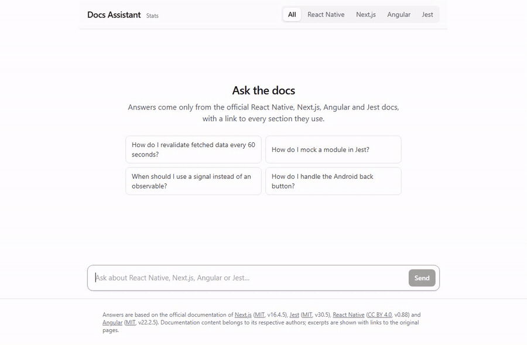
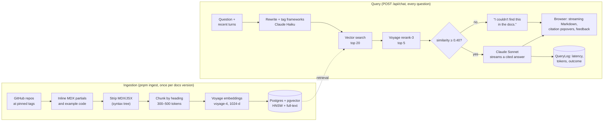

# Docs Assistant

Ask questions about the official **React Native, Next.js, Angular and Jest** docs and get a
streamed Markdown answer that cites the exact doc sections it used, or says plainly that the docs
don't cover it.

It runs locally with Docker and your own API keys: see [Run it locally](#run-it-locally).



- **Grounded answers.** Claude answers only from the retrieved doc sections, cites them as [1]–[5],
  and each marker opens the section's excerpt with a link to the exact heading on the official site.
- **Measured, not guessed.** A 68-question eval scores retrieval, answers, refusals, latency and
  cost; it drove every default below (vector + reranker over hybrid, the not-found threshold).
- **98% of questions find the right page in the top 5**, every answerable question gets answered,
  every off-topic one is refused, for about 1¢ a question.
- Hand-written retrieval (no LangChain or vector-DB SaaS): Postgres + pgvector, Voyage embeddings
  and reranking, Claude for answers.

## How it works



1. **Ingestion** downloads each framework's docs at a pinned version, inlines content pages pull
   in from elsewhere (React Native's setup partials, Angular's 842 example files), strips MDX/JSX
   on the Markdown syntax tree, splits pages by heading into 300–500-token chunks with the heading
   path and anchor, embeds them and stores them. Unchanged files are skipped by content hash.
2. **A question** is rewritten to stand alone (when there's history) and tagged with the
   frameworks it's about, embedded, matched against the top 20 chunks, and reranked to the best 5.
3. **Claude** answers from those five numbered chunks only, citing them, or replies with the exact
   not-found sentence. The server streams NDJSON events: sources, text deltas, then citations,
   token usage and an id for feedback. Every request is logged; stopping an answer cancels the
   Claude request.

| Framework    | Docs source                                                        | Version | Docs | Chunks |
| ------------ | ------------------------------------------------------------------ | ------- | ---- | ------ |
| Next.js      | `vercel/next.js` `docs/01-app`, `docs/03-architecture`             | 16.4.5  | 303  | 2,642  |
| React Native | `react/react-native-website` `website/versioned_docs/version-0.88` | 0.88    | 225  | 2,243  |
| Angular      | `angular/angular` `adev/src/content`                               | 22.2.5  | 315  | 3,403  |
| Jest         | `jestjs/jest` `website/versioned_docs/version-30.5`                | 30.5    | 37   | 602    |

## Evaluation

68 questions (`eval/questions.json`: 15+ per framework, 5 of them cross-framework, plus 10 the
docs don't cover; drafted by Claude from the pinned docs and machine-checked) run through the
real pipeline and are scored for retrieval (hit@5, MRR, framework accuracy), answers (must-mention
facts, faithfulness graded claim by claim by a stronger Claude model, refusal accuracy), latency
and cost. See [eval/README.md](eval/README.md).

<!-- eval-results:start -->

Latest run: 2026-11-08 (commit `7378a95`), 68 questions, top-5, not-found threshold 0.4. Answers: `claude-sonnet-5-5` (effort low); judge: `claude-opus-5-5`; embeddings: `voyage-4`.

| Mode              | Hit@5 | MRR   | Framework acc. | Must-mention | Faithfulness | Refusal acc. | TTFT p50 | TTFT p95 | Cost / question |
| ----------------- | ----- | ----- | -------------- | ------------ | ------------ | ------------ | -------- | -------- | --------------- |
| vector            | 91.4% | 0.754 | 93.1%          | 95.7%        | 99.6%        | 100.0%       | 2.0 s    | 3.1 s    | $0.0093         |
| vector + rerank-3 | 98.3% | 0.868 | 93.8%          | 100.0%       | —            | 100.0%       | 2.5 s    | 3.8 s    | $0.0102         |
| keyword           | 67.2% | 0.427 | 88.6%          | 71.6%        | —            | 91.2%        | 1.9 s    | 3.6 s    | $0.0077         |
| hybrid            | 91.4% | 0.736 | 92.4%          | 93.1%        | —            | 100.0%       | 1.9 s    | 3.1 s    | $0.0092         |

Hit@5 by framework:

| Mode              | React Native | Next.js | Angular | Jest   |
| ----------------- | ------------ | ------- | ------- | ------ |
| vector            | 87.5%        | 93.3%   | 93.3%   | 93.3%  |
| vector + rerank-3 | 100.0%       | 100.0%  | 93.3%   | 100.0% |
| keyword           | 75.0%        | 73.3%   | 46.7%   | 80.0%  |
| hybrid            | 81.3%        | 93.3%   | 93.3%   | 100.0% |

<!-- eval-results:end -->

What the eval changed (retrieval-only runs and a threshold sweep, then the full runs above):

- **A reranker made the biggest difference.** Retrieving the top 20 by vector similarity and
  letting Voyage `rerank-3` pick the best 5 raised hit@5 from 93.1% to 98.3% (React Native
  87.5% → 100%), MRR from 0.774 to 0.868 and must-mention from 95.7% to 100%, for about 0.5 s
  more before the first token and $0.001 more per question. It's on by default
  (`RERANK_MODEL=none` turns it off); `rerank-3-lite` scored the same but wasn't faster here.
- **Vector is the default mode, not hybrid.** With plain Reciprocal Rank Fusion (equal weights),
  hybrid found the right page for 84.5% of questions against vector's 93.1%: keyword search is
  weak on everyday phrasing, and chunks both lists half-agreed on pushed vector's best hits out
  of the top 5. Weighting keyword results down (`HYBRID_KEYWORD_WEIGHT`: 0.5 → 86.2%,
  0.25 → 86.2%, 0.1 → 89.7%) closes most of the gap; at 0.1 hybrid ties vector on hit@5 but
  still trails on MRR and must-mention.
- **The not-found threshold is a pre-filter, not the refusal mechanism.** With the threshold at
  0, Claude alone answered all 58 answerable questions and refused all 10 off-topic ones.
  Similarity can't separate the two groups (off-topic questions scored 0.35–0.67, answerable ones
  0.44–0.80), so the threshold is 0.40, just under the lowest answerable score: obvious off-topic
  questions skip the answer call, and no answerable one is lost.
- Faithfulness (99.6%) was graded by `claude-opus-5-5` on the plain vector run only, to keep the
  runs cheap. All tuning together (retrieval sweeps, threshold sweep, final runs) cost about $5.

## Design decisions

- **Retrieval written by hand.** Chunking, SQL (pgvector `<=>` with an HNSW index, `ts_rank` over a
  generated `tsvector`), fusion and reranking are ~550 lines that can each be explained and tested.
  Filtered vector queries turn on pgvector 0.8's iterative index scans, so a framework filter still
  returns a full top-k.
- **Cosine similarity stays attached to every result**, whichever mode or reranker ordered it, so
  the not-found threshold means the same thing everywhere (RRF sums and rerank scores aren't on a
  comparable scale).
- **The model decides "not found".** The system prompt asks for one exact sentence when the
  context doesn't cover the question; the eval showed this is more reliable than any similarity
  cut-off, which only filters obvious off-topic questions.
- **Docs are cleaned on the syntax tree, never with regexes**: Jest pages have `import` lines
  inside code blocks, and Angular pages reference example code by path. Inlining that code added
  ~340K tokens of real examples the index would otherwise miss.
- **Citation URLs are verified against the live sites.** angular.dev serves its home page for any
  path, so URLs come from the site's own navigation file and were checked against its sitemap
  (315/315); React Native and Next.js anchors were sampled against the rendered pages.
- **NDJSON over Server-Sent Events.** The chat is a POST with a JSON body, which `EventSource`
  can't send; NDJSON events are validated with the same Zod schemas on server and client.
- **Prompt caching was measured, not shipped.** The fixed part of the prompt is ~300 tokens,
  under Sonnet's 512-token caching minimum, and the per-question context is never reused: two
  identical requests showed 0 tokens written to or read from the cache. Padding the prompt to
  make caching apply would cost more than it saves.
- **Safe to host if you want to.** It's built to run locally, but optional limits
  (`RATE_LIMIT_PER_HOUR`, `DAILY_QUESTION_LIMIT`, off by default) cap questions per visitor and
  per day, counted from QueryLog with visitor IPs stored only as a salted hash. The model's HTML is
  never rendered.

## Run it locally

Requirements: Docker, API keys for [Anthropic](https://console.anthropic.com) and
[Voyage AI](https://dashboard.voyageai.com). For development, also Node 24+ and pnpm.

```bash
cp .env.example .env      # add ANTHROPIC_API_KEY and VOYAGE_API_KEY
docker compose up --build
docker compose run --rm app pnpm ingest
```

The app runs on http://localhost:3000 (stats at `/stats`) and applies database migrations on
boot. If ports 5432 or 3000 are taken, set `DB_PORT` / `APP_PORT` in `.env` (and keep the port in
`DATABASE_URL` in sync with `DB_PORT`). Ingesting all four frameworks embeds about 1.9M tokens
(within Voyage's free allowance; add a payment method to lift its 3-requests-a-minute limit).

### Develop

```bash
pnpm install
docker compose up -d db
pnpm db:deploy
pnpm dev
```

| Command                                      | What it does                                                 |
| -------------------------------------------- | ------------------------------------------------------------ |
| `pnpm typecheck` / `lint` / `format:check`   | Static checks                                                |
| `pnpm test`                                  | Unit + integration tests (real Postgres, mocked APIs)        |
| `pnpm test:e2e`                              | Playwright smoke tests (`pnpm exec playwright install` once) |
| `pnpm ingest [--framework jest] [--dry-run]` | Fetch, clean, chunk, embed, store                            |
| `pnpm run search "question" [--mode …]`      | Top chunks with scores and sources                           |
| `pnpm eval:check` / `eval` / `eval:report`   | Validate questions, run the eval, update the README table    |

The chat API can also be used directly:

```bash
curl -N -X POST http://localhost:3000/api/chat -H 'content-type: application/json' \
  -d '{"question":"How do I revalidate fetched data every 60 seconds?"}'
```

```text
{"type":"meta","question":"…","frameworks":["nextjs"],"frameworksSource":"detected","sources":[{"n":1,…}]}
{"type":"text","text":"Pass `next.revalidate` to `fetch` [1] …"}
{"type":"done","answered":true,"outcome":"answered","citations":[{"n":1,"chunkId":"…","url":"…"}],"usage":{…},"topSimilarity":0.63,"queryId":"…"}
```

## Stack

Next.js 16 (App Router) + TypeScript, PostgreSQL 16 + pgvector 0.8, Prisma 7, Claude API
(Sonnet 5.5 answers, Haiku 5.5 rewrites, Opus 5.5 as eval judge), Voyage AI (`voyage-4`
embeddings, `rerank-3`), Tailwind CSS, Vitest, Playwright, Docker Compose, GitHub Actions.

## Attribution

Documentation content belongs to its respective projects. Next.js, Jest and Angular docs are
MIT-licensed; React Native docs are licensed under
[CC BY 4.0](https://github.com/react/react-native-website/blob/main/LICENSE-docs). The app's
footer credits each source with a link to its license. Doc files are downloaded at ingest time
and aren't committed to this repository.
